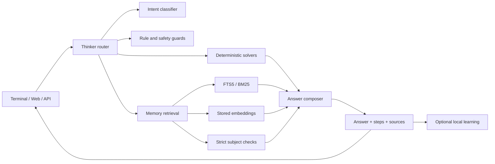

# Architecture

TenSeiAi is a small, complete local AI stack. The design goal is not to imitate
a large language model. The goal is to make a useful, inspectable assistant
that fits in a file and runs on a CPU.

## Request flow



The `Thinker` in `source/tensei/thinker.py` is the coordinator. It classifies
the request, checks the date/time and local identity questions, invokes code or
math solvers when appropriate, retrieves local knowledge, and finally composes
a clean answer. It can optionally research the web when the local memory is
weak and the user has not disabled network access.

## Main modules

| Module | Responsibility |
|---|---|
| `tensei/thinker.py` | Routing, retrieval orchestration, grounding, answer composition |
| `tensei/brain.py` | Loads and trains the neural components; brain metadata |
| `tensei/memory.py` | SQLite knowledge store, FTS5/BM25, embeddings, topics, learning |
| `tensei/embed.py` | Hashed/learned embedding projection |
| `tensei/nn.py` | Small numpy MLPs and training helpers |
| `tensei/lm.py` / `tensei/transmoe.py` | Transformer/MoE language core |
| `tensei/codecore.py` / `tensei/codesmith.py` | Deterministic code generation |
| `tensei/mathcore.py` / `tensei/reasoncore.py` | Arithmetic, units, logic, and reasoning helpers |
| `tensei/model_file.py` | TSM1/TSMC model container reader and writer |
| `tensei/build.py` | Builds the portable `.pyz` application |
| `tensei/server.py` | Local web server and HTTP API |
| `tensei/cli.py` | Terminal launcher, chat, one-shot questions, build/export commands |
| `tensei/android.py` | Chaquopy integration helper |
| `web/index.html` | Dependency-free local chat UI |

## Storage

The knowledge store is SQLite. The important tables include:

- `qa` question/answer rows with category, source, confidence, and feedback.
- `docs` passages with page title, URL, text, topic, and timestamps.
- `topics` the research/learning queue.
- Full-text search structures for lexical retrieval.
- Embedding blobs used by the neural retrieval path.

The shipped snapshot is a starting point. Runtime learning is written to the
active `TENSEI_HOME` (normally `~/.tensei_ai`). A source build uses
`source/data/tensei.db`; the compressed source snapshot is restored by
`scripts/prepare_assets.py`.

## Model container

TenSeiAi uses its own container, not GGUF. The implementation is in
`source/tensei/model_file.py`.

```text
TSM1 or TSMC
uint32 meta_length
JSON metadata
uint32 blob_count
for each blob:
  uint16 name_length
  name
  uint64 payload_length
  payload
```

`TSMC` payloads are compressed with LZMA or zlib depending on the blob. The
container stores the trained `brains/`, the SQLite database, and the web UI.
The `.tsei` file is portable across operating systems because the arrays and
database are platform-independent. Native acceleration is optional and is not
required to load a model.

The release `.pyz` is a Python zipapp with a shell bootstrap. It embeds a
TSM1 model and packed engine modules. It still requires a host Python 3
interpreter; it does not bundle CPython or numpy.

## Build path

```text
assets/tensei.db.gz
        │
        ▼
scripts/prepare_assets.py  ──►  source/data/tensei.db
        │
        ▼
source/tensei/model_file.py
        │
        ├──► dist/TenSeiAi.tsei
        │
        └──► source/tensei/build.py ──► dist/TenSeiAi.pyz
```

The release build runs with `TENSEI_HOME=source`, `TENSEI_OFFLINE=1`, and
`TENSEI_NO_LEARN=1`. It does not download a model or call a hosted service.

## Security boundaries

- The server is a local development/chat server, not a hardened multi-user
  service. It has no authentication and enables permissive CORS.
- The default bind address is `127.0.0.1`. Do not expose it publicly without a
  reverse proxy, authentication, and rate limiting.
- The model container parser is not a sandbox. Do not load model files from
  untrusted sources without reviewing the parser and testing in isolation.
- Web research sends search queries to external services when enabled.
- No signing key is included. Build and sign Android APKs with your own key.

See [SECURITY.md](../SECURITY.md) and [BUILD.md](BUILD.md).
